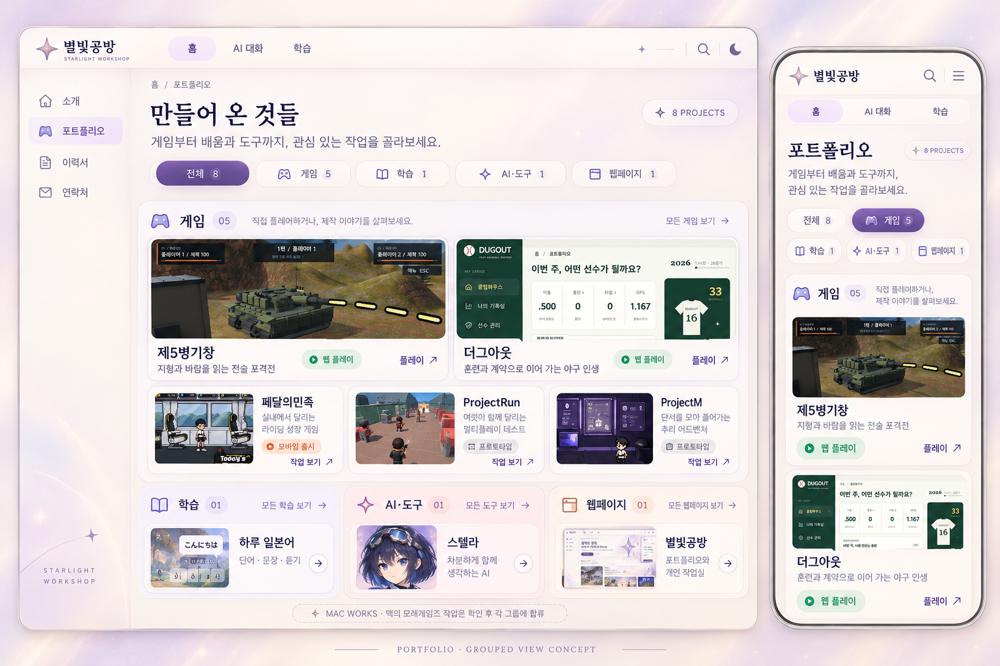

# 클로드 전달: 별빛공방 포트폴리오 그룹화와 Mac 모래게임즈 작업 반영

작성: 2026-10-30 · 사용자 요청에 따른 전달 문서

## 먼저 읽을 요약

포트폴리오가 큰 카드와 긴 설명으로 길어졌다. **게임 / 학습 / AI·도구 / 웹페이지**로 나눠, 첫 화면에서 작업의 종류와 대표작을 빠르게 알아볼 수 있게 바꾸고 싶다.

**후속 사용자 승인으로 작품 중심 그룹화 UI를 구현했다.** 사용자가 이전 카드 중첩 시안을 AI스럽다고 지적했고, Pentagram의 분류 방식과 Studio Mast의 이미지 배치를 참고한 방향에 “해줘”로 승인했다. 테두리·그림자·알약 배지를 줄이고 그룹 제목·얇은 구분선·실제 이미지·짧은 제목으로 정리했다. Mac에 있는 모래게임즈 자료는 접근하지 못했으므로 아래 목록에 임의로 추가하지 않았다. Mac의 Claude는 실제 프로젝트와 맡은 역할·실행 화면을 확인해 기존 항목과 합치거나 새 항목을 제안해 달라.

현재까지 구현된 파스텔 별빛 UI, 스텔라의 미오 초상과 성격, 웹 게임 플레이, 비공개 GitHub 링크 숨김은 유지한다.

<details>
<summary>이전 카드형 시안 기록 — 현재 구현의 목표 디자인이 아님</summary>



시안 PNG는 이미지 생성 도구로 만든 **구성 검토용 이미지**다. 일부 썸네일·아이콘·문구는 배치 예시이며, 실제 게임 화면을 새로 검증했다는 증거가 아니다. 구현할 때 이 PNG를 페이지 배경으로 쓰거나 생성된 게임 썸네일을 실제 캡처라고 사용해서는 안 된다. 기존 실제 스크린샷을 사용한다. 상단 검색·달 아이콘도 신규 기능 요청이 아니다.

</details>

## 사용자가 요청한 것

> 지금 포트폴리오가 너무 늘어져있어. 게임이랑 학습 그리고 페이지 등으로 나눠서 그룹화하고 볼 때 시각적으로 잘 보이게 정렬한 시안을 보여줘. 맥에서 하는 모래게임즈 관련 내용들도 같이 포함하고 싶으니 클로드 전달용 MD 파일을 만들어둬.

이 문서는 그 요청을 Mac 작업으로 이어 주기 위한 것이다. 그룹화 자체는 후속 승인으로 구현했으므로 같은 기능을 새로 만들지 않는다. **Mac 자료 확인 결과와 기존 항목에 합칠 내용을 먼저 정리하고, 추가할 콘텐츠 범위를 확정한다.** 확인하지 못한 작업을 완성·출시·공개 프로젝트로 소개하지 않는다.

## 저장소와 현재 기준

- 앱: `JinUk-E/StudyLangss`, 브랜치 `starlightForge`
- 원격: <https://github.com/JinUk-E/StudyLangss.git>
- 운영: <https://starlightforge.duckdns.org>
- Windows 앱 경로: `D:\MoraeGames\04.AI\PesnalVo\StudyLangss`
- 기존 8개 자료 확인 기준 코드: `463e811`. 이전 카드형 시안 문서 커밋은 `c5d1e76`이며, 현재 그룹화 코드는 이 문서의 후속 변경과 함께 반영된다.
- Mac의 체크아웃·모래게임즈 상위 폴더·추가 저장소 경로는 **아직 모른다.** Windows 경로를 Mac 경로로 추정하지 않는다.
- 먼저 현재 폴더의 `AGENTS.md` / `CLAUDE.md`와 적용되는 팀 규칙을 확인하고 `git status --short`로 다른 작업을 보존한다. 알려진 팀 저장소의 일반 동기화는 사용자 상시 승인이 있다.

## 현재 구현한 화면 구성

### 1. 전체 보기: 소개보다 작품을 먼저

상단의 `홈 / AI 대화 / 학습`과 홈 영역의 왼쪽 하위 메뉴는 유지한다. 포트폴리오 페이지의 본문 안에만 `전체 / 게임 / 학습 / AI·도구 / 웹페이지` 그룹 선택을 둔다. 상세 장르마다 필터를 늘어놓지 않는다.

첫 화면은 작은 제목과 짧은 설명, 그룹 선택, 작품으로 시작한다. 큰 자기소개·거대한 유리별 히어로·긴 기술 설명은 포트폴리오 목록 위에 반복하지 않는다. 소개는 홈에, 자세한 설명은 프로젝트 상세에 둔다.

### 2. 게임: 이미지를 중심으로 한 그리드

- PC는 3열, 중간 화면은 2열, 모바일은 1열이다. 그룹 안에서는 기존 공개 응답의 정렬을 유지하며 DB의 `order`를 바꾸지 않는다.
- 작품마다 큰 둥근 박스를 만들지 않는다. 실제 썸네일과 제목·장르·기간, 최대 두 줄 요약을 보여 주고 기술 태그·긴 담당 업무·갤러리는 상세에 둔다.
- 확인된 웹 플레이 가능 표시는 제5병기창·더그아웃에만 짧은 글씨로 붙인다. 일반 카드는 기존대로 프로젝트 상세를 열고, 그 안에서 웹 플레이를 시작한다.
- 스토어 출시·프로토타입이라는 세부 장르 정보도 유지한다. 공개된 게임이라고 모두 웹에서 플레이할 수 있는 것은 아니다.

### 3. 학습·AI·웹페이지: 짧은 그룹 패널

전체 보기의 PC 화면에서는 세 그룹을 아래에 나란히 두고, 썸네일과 제목이 있는 짧은 목록으로 보여 준다. 그룹마다 실제 공개 개수를 계산하고, 그룹 선택 시 해당 작업만 보여 준다. 그룹마다 처음 6개까지 표시하며 더 보기로 전체 항목을 펼친다. 그룹을 오가도 펼친 상태를 유지한다. 새 프로젝트의 그룹을 지정하지 않으면 `기타`에 남아 누락되지 않는다.

모바일은 그룹 선택 후 해당 그룹을 한 열로 보여 준다. 선택하지 않은 다른 그룹까지 긴 목록으로 모두 반복하지 않는다. 가로 스크롤은 그룹 선택 영역에만 허용하고 페이지 전체가 옆으로 넘치지 않게 한다.

### 4. 유지할 디자인

사이트의 크림색과 보라 포인트는 유지하되 포트폴리오 작품 목록에서는 유리 카드·큰 모서리·그림자·반복 배지를 제거했다. 그룹 제목과 구분선으로 영역을 나눈다. 꽃·꽃잎 효과는 없다. 스크린샷은 HUD가 잘리지 않도록 기존 `object-fit: contain`을 유지한다. 실제 브라우저 사용이 꺼져 있어 변경 후 실제 화면 캡처·모바일 넘침·인쇄 결과는 아직 확인하지 못했다. 생성 시안을 그 증거로 사용하지 않는다.

## 확인된 기존 항목: 8개

아래는 저장소의 기본 콘텐츠 기준이다. 실제 화면의 그룹별 숫자는 **현재 공개된 프로젝트 데이터에서 계산**한다. DB에 사용자가 추가·수정·삭제한 항목이 있을 수 있으므로 숫자 8이나 아래 목록을 운영 DB에 강제로 맞추지 않는다.

| 그룹 | 프로젝트 | 기존 ID | 현재 확인 근거 / 표시 방향 |
|---|---|---|---|
| 게임 | 페달의민족 · Tour de Indoor | `8d47aa00-2000-4000-8000-000000000001` | 모바일 출시, 기존 App Store 링크. 팀 프로젝트이며 역할을 분리해서 소개 |
| 게임 | 제5병기창 · ProjectF | `8d47aa00-2000-4000-8000-000000000002` | `/play/projectf/` 웹 플레이 |
| 게임 | ProjectRun · 경찰과 도둑 | `8d47aa00-2000-4000-8000-000000000003` | 프로토타입. 웹 플레이 여부는 새로 검증하기 전 표시 금지 |
| 게임 | ProjectM · 사진 조사와 추리 | `8d47aa00-2000-4000-8000-000000000004` | 프로토타입. 비공개 소스의 GitHub 링크 숨김 유지 |
| 게임 | 더그아웃 · 야구인생게임 | `8d47aa00-2000-4000-8000-000000000005` | `/play/dugout/` 웹 플레이 |
| 학습 | 하루 일본어 | `8d47aa00-1000-4000-8000-000000000001` | `/study/`, 현재 언어 학습 기능·접근 권한 유지 |
| AI·도구 | 스텔라 · AI 대화 | `8d47aa00-1000-4000-8000-000000000002` | `/chat/`, 미오 초상·스텔라 이름과 성격 유지 |
| 웹페이지 | 별빛공방 웹사이트 | `8d47aa00-1000-4000-8000-000000000003` | 포트폴리오·이력서·개인 작업실 |

`게임 5 / 학습 1 / AI·도구 1 / 웹페이지 1`은 이 기본 목록의 집계다. 같은 저장소로 만든 학습·AI·사이트를 서로 다른 포트폴리오 항목으로 소개하는 기존 구조는 유지하되, Mac에서 같은 작업을 다른 이름으로 또 추가하지 않는다.

## Mac의 모래게임즈 자료를 확인하는 순서

1. **위치 확인:** 현재 Mac의 앱 체크아웃과 모래게임즈 프로젝트 상위 폴더를 확인한다. 찾을 근거가 없으면 사용자에게 상위 폴더 하나만 물어본다. 이 문서의 Windows 경로를 그대로 쓰지 않는다.
2. **목록 작성:** 해당 폴더 안에서 사용자 요청과 관련된 저장소·README·실행 가능한 앱/사이트·보존된 실행 화면을 확인한다. 계정 비밀번호·토큰·서명 키·고객 데이터는 수집하거나 전달 문서에 복사하지 않는다.
3. **역할 확인:** 게임/앱의 기능과 별개로 사용자가 직접 맡은 부분, 팀이 맡은 부분, 현재 단계와 공개 가능한 화면을 구분한다. 자동 빌드·Jenkins·fastlane 작업은 기존 페달의민족의 상세 내용과 겹치는지 먼저 확인한다.
4. **중복 판단:** 프로젝트 이름뿐 아니라 저장소 주소와 기존 ID를 비교한다. 동일 프로젝트의 Mac 작업은 기존 항목의 설명·실제 화면을 갱신하는 것이 우선이다. 단독 서비스로 볼 만한 새 작업만 새 ID로 제안한다.
5. **그룹 제안:** 게임은 `게임`, 언어/교육 서비스는 `학습`, AI 서비스·개발 도구는 `AI·도구`, 회사 소개·랜딩·브랜드 사이트는 `웹페이지`로 분류한다. **모래게임즈는 출처/브랜드 표시이지 다섯 번째 기능 그룹이 아니다.** 관련성이 확인된 항목에만 모래게임즈 배지를 제안한다.
6. **공개 검토:** 공개 여부가 확인되지 않은 항목은 초안으로 정리한다. 사설 저장소를 공개하거나 비공개 코드·내부 URL을 포트폴리오에 노출하지 않는다. 외부 플레이·스토어 링크는 실제 접근 가능한지 확인하고 기록한다.
7. **사용자에게 제시:** 확인된 Mac 작업 목록과 기존 항목에 합칠 부분, 새 항목으로 넣을 부분을 짧은 표로 보여 준다. 그 결과를 반영한 그룹 수와 배치를 제안한 뒤 구현 범위를 확정한다.

### 프로젝트마다 받을 자료

```text
이름 / 기존 항목과 같은 작업인지:
Mac의 실제 폴더 / 저장소(비공개면 공개 문서에 주소 제외):
그룹: 게임 | 학습 | AI·도구 | 웹페이지
모래게임즈와의 관계:
한 줄 소개 / 사용자가 맡은 역할 / 팀원이 맡은 역할:
현재 단계: 작업 중 | 프로토타입 | 웹 공개 | 스토어 출시
실제 실행 화면 경로 / 확인 날짜:
공개 가능한 링크 / 링크 확인 결과:
공개해도 되는 설명과 이미지 / 추가 확인이 필요한 내용:
기존 ID 또는 새 항목 제안:
```

현재 이 양식에 채울 Mac 자료는 확인하지 못했다. ‘Mac Studio에서 운영한다’는 이유만으로 모든 항목을 모래게임즈 실적으로 분류하지 않는다.

## 구현할 때 확인할 코드와 보존할 동작

| 위치 | 확인할 내용 |
|---|---|
| `public/site/app.js` | 현재 단일 목록·장르 필터·카드·상세 모달·직접 경로 |
| `public/site/index.html`, `public/site/editorial.css` | 목록 영역의 그룹 패널과 압축 카드, 홈 히어로와 분리 |
| `public/shared/shell.js`, `public/shared/shell.css` | 상단 영역·왼쪽 하위 메뉴·계정별 노출, 기존 로고 이동 버그 재발 방지 |
| `lib/portfolio-store.mjs` | 관리자의 편집 데이터, 공개/대표/정렬·삭제 보존 |
| `content/career-content.mjs`, `content/portfolio-defaults.mjs`, `content/portfolio-latest.mjs`, `content/baseball-project.mjs` | 기존 ID와 기본 콘텐츠, 이미 적용된 일회성 갱신 |
| `content/web-games.mjs`, `public/site/play.js` | 고정 공개 게임 목록, 플레이 시작·종료·전체화면 |
| `lib/public-repository-links.mjs` | 공개 API에서 비공개·확인 실패 GitHub 링크 제거 |
| `public/site/resume.js` | 이력서 프로젝트 목록·공개 열람·인쇄 흐름 |

- `category`는 세부 장르로 유지한다. 별도의 optional `group` JSON 필드에 `games / learning / tools / web / other`를 저장한다. `content/portfolio-groups.mjs`가 선택지와 기존 8개 ID 기본 분류를 공유한다. 관리자에서 그룹을 선택할 수 있고 신규 기본값은 기타다. 그룹은 공개 권한과 별개다.
- 기존 데이터에는 새 필드를 일괄로 쓰지 않는다. 그룹이 없으면 기존 ID를 기준으로 표시하고, 알 수 없는 ID는 기타다. 구 클라이언트가 수정 요청에서 group을 보내지 않아도 이미 저장한 그룹은 보존한다. 잘못된 그룹 입력은 400으로 거절한다.
- 새 그룹 기본값을 도입해도 사용자 편집·공개·정렬·삭제를 재시작 때 덮어쓰지 않는다. 알 수 없는 프로젝트를 제목 추측만으로 잘못 분류하지 말고 미분류로 보존해 관리자가 정리할 수 있게 한다.
- 익명 화면의 숫자·대표작·그룹은 공개 데이터로만 만든다. 비공개 항목의 이름·개수·썸네일이 빈 그룹이나 배지로 노출되지 않게 한다.
- `/projects/:id` 직접 진입·모달 닫기·뒤로 가기·수정 키 클릭·분류 전환을 유지한다. 이력서·관리자 편집도 영향 범위를 확인한다.
- AI/학습 로그인과 계정별 권한, 스텔라의 공통 페르소나와 초상, Qwen 음성 설정은 이 작업에서 바꾸지 않는다.
- GitHub Pages가 없는 게임에 실행 버튼을 만들어 놓지 않는다. 게임 빌드 ZIP/WebGL 산출물을 이 앱 Git 기록에 넣지 않는다.

## 완료 확인과 인계

실제 구현 시 그룹별 공개 개수·선택·더 보기·빈 그룹·직접 링크·권한 유지와 사용자 편집 보존을 확인한다. PC와 700/390/320px에서 넘침·텍스트 잘림·썸네일 비율을 실제 브라우저로 확인하고, 키보드 탐색·모션 감소·이력서 인쇄도 확인한다. 기존 Node 테스트와 필요한 Mac 검증을 실행하되, 생성 시안이나 모의 모델 응답을 실제 UI/게임/음성 검증으로 표현하지 않는다.

Mac 자료 확인 후 돌려줄 내용:

1. 기존 프로젝트에 합칠 자료 / 새 프로젝트 제안 표.
2. 공개·미확인 자료와 실제 캡처 경로.
3. 그룹별 개수와 정렬·대표작 배치 제안.
4. 사용자가 확정한 구현 범위, 변경 파일·검증 결과·운영 반영 여부.

Windows 쪽은 Mac에 접속하거나 운영 사이트를 업데이트하지 않았다. **이제 산출물에는 그룹화 UI 코드도 포함되지만, 운영 Mac에 반영됐다는 뜻은 아니다.** Mac 적용 후 실제 화면과 새 콘텐츠를 확인한다. 맥의 모래게임즈 자료는 여전히 미확인 상태다.
